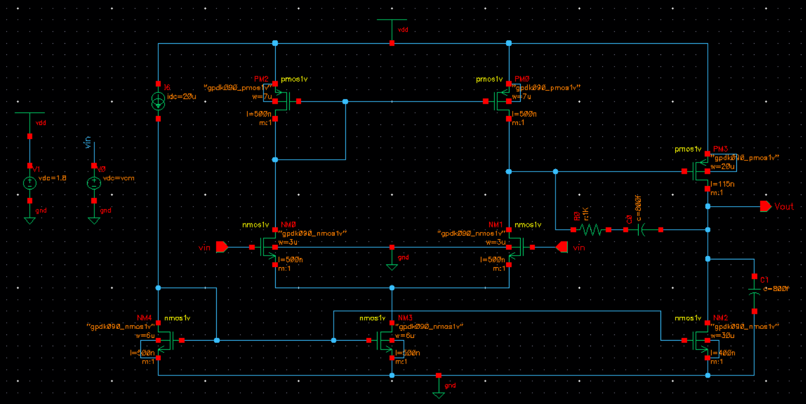
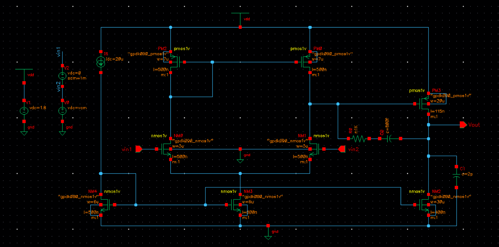
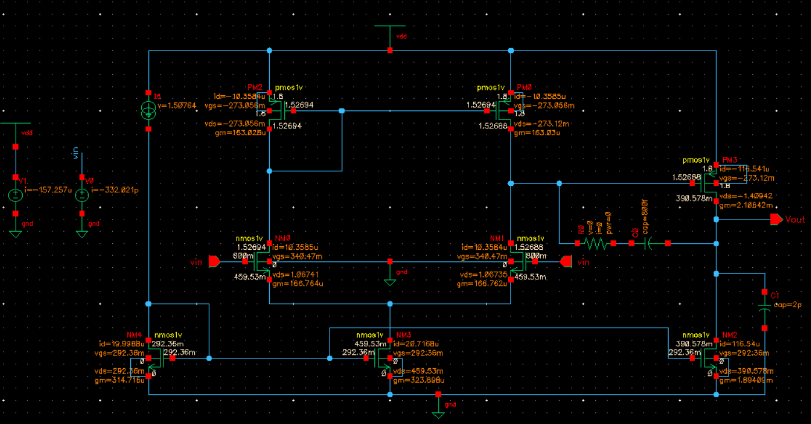
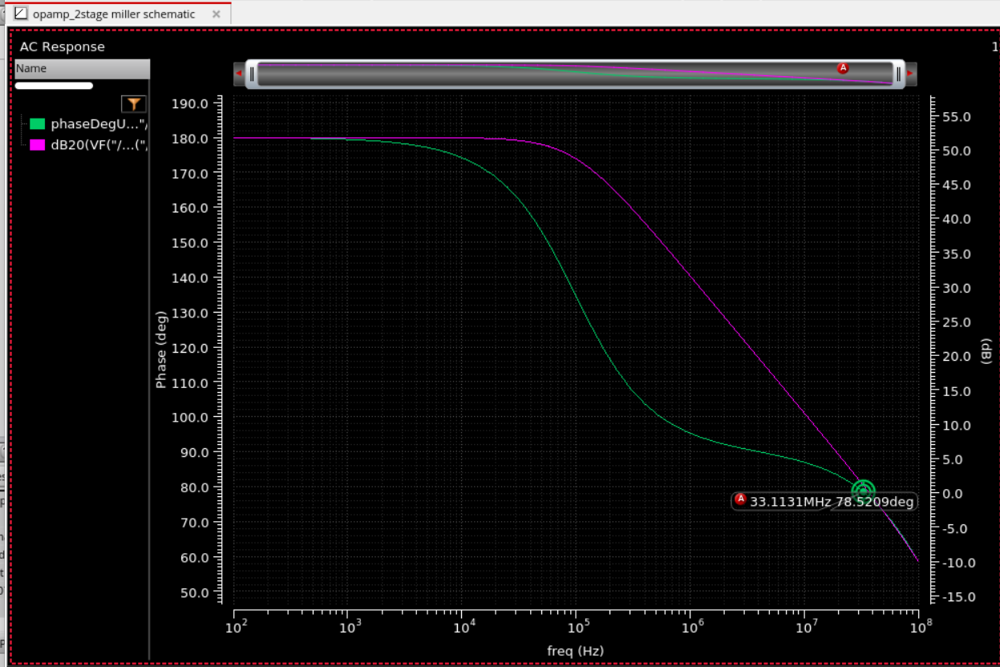
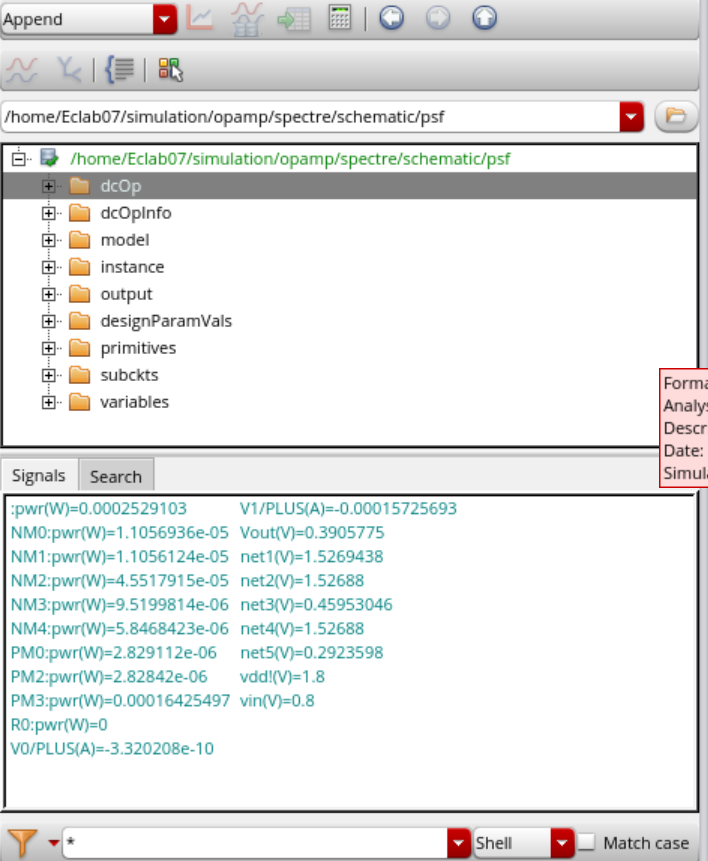

# Two Stage Miller Compensated Op-Amp

This project is about designing and simulating a two-stage Miller compensated CMOS operational amplifier using Cadence Virtuoso with the GPDK 90 nm CMOS technology.

## Circuit

The op-amp has two gain stages.

- **First stage:** The input differential pair compares the two input voltages and converts the difference into a voltage signal. The active load/current mirror helps provide gain.
- **Second stage:** This stage provides additional voltage gain and drives the output.
- **Miller compensation:** A compensation capacitor is connected between the output of the second stage and the output of the first stage. A resistor is used along with the capacitor to help control the frequency response and improves stability when the op-amp is used with feedback.

## Schematic

### DC setup

### AC setup

## Simulations and results

### 1. DC operating point

The DC operating point simulation is used to check the bias voltage and current of the transistors. This verifies whether the transistors are biased properly before checking the frequency response.

### 2. AC analysis

AC analysis shows how the gain and phase change with frequency. From the response, parameters such as low-frequency gain, unity-gain frequency and phase margin can be studied. The Miller compensation network affects this response by changing the pole locations and improving stability.

### 3. Power

The power result is used to check the power consumed by the circuit under the simulated bias conditions.

## Design calculations

The calculations used for the design are available in [calculations.pdf](calculations.pdf).

## Folder structure

- `schematic/` – circuit schematic images for DC and AC setups.
- `simulation/` – simulation files for DC and AC analysis.
- `results/` – simulation plots and operating-point results.
- `calculations.pdf` – design calculations.

## What I learnt

- How the two gain stages work together in a CMOS op-amp.
- Why Miller compensation is added and how it affects the gain and phase response.
- How to check the DC operating point before analysing AC performance.
- How to use Cadence Virtuoso simulations to study gain, stability and power consumption.
